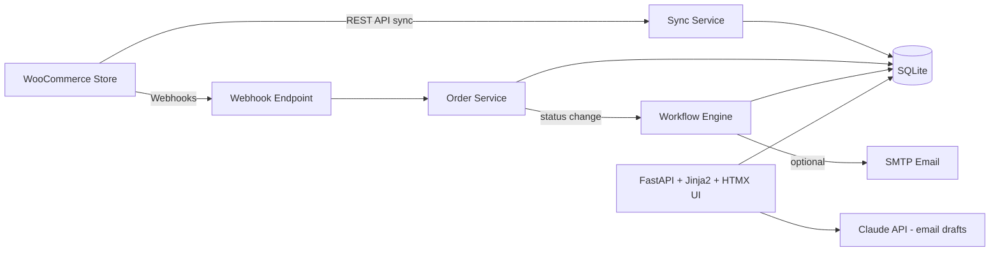

# WooCRM - CRM System Integrated with WooCommerce

A lightweight CRM that syncs customers and orders from a WooCommerce store and adds customer management, order tracking and automated communication workflows on top.

Built for the Kilowott "CRM System Integration" challenge.

## Features

| Challenge requirement | What's implemented |
|---|---|
| **Customer data management** | Synced customer list with search, detail page with order history, notes and tags |
| **Order tracking** | Order list with status filters, order detail, status timeline, live updates via WooCommerce webhook |
| **Communication workflows** | Template-based emails triggered by order events, 30-day win-back campaign, manual messages, AI-drafted emails, full message timeline per customer |
| **WooCommerce integration** | REST API sync (`/wp-json/wc/v3`) + webhook receiver; falls back to realistic mock data when no store is configured |

## Architecture



## Tech stack
FastAPI, SQLAlchemy, SQLite, Jinja2, HTMX, Tailwind CSS (CDN), httpx. Optional: SMTP, Anthropic API.

## Quick start

```bash
git clone https://github.com/NidhiKanthamraju/woocommerce-crm.git
cd woocommerce-crm
python -m venv venv && source venv/bin/activate
pip install -r requirements.txt
cp .env.example .env            # optional - works without any keys
python data/generate_mock.py    # generates sample WooCommerce data
uvicorn app.main:app --reload
```

Open http://localhost:8000 and click **Sync WooCommerce**.

Or with Docker: `docker build -t woocrm . && docker run -p 8000:8000 woocrm`

## Connecting a real WooCommerce store
1. WooCommerce -> Settings -> Advanced -> REST API -> create a key (Read/Write).
2. Put `WOO_URL`, `WOO_KEY`, `WOO_SECRET` in `.env`.
3. WooCommerce -> Settings -> Advanced -> Webhooks -> add `Order created` and `Order updated` pointing to `https://<your-host>/webhooks/woocommerce`.

## Demo flow
1. Sync data, then browse Customers and open a profile.
2. Change an order's status, which adds a timeline event and triggers an email.
3. Simulate a WooCommerce webhook:
```bash
   curl -X POST localhost:8000/webhooks/woocommerce -H "Content-Type: application/json" \
     -d '{"id":5001,"customer_id":1,"status":"processing","total":"2499","line_items":[{"name":"Keyboard","price":2199,"quantity":1}]}'
```
4. Open Workflows and run the win-back campaign.
5. On a customer page, draft an email with AI.

## Screenshots
| Dashboard | Customer detail |
|---|---|
|  |  |
| **Orders** | **Workflows** |
|  |  |

## Design decisions
- **Upsert-based sync** keyed on WooCommerce IDs, so syncing is idempotent.
- **Single `set_status` function** for all status changes (UI and webhook) so timeline and workflows can never be bypassed.
- **Graceful fallbacks:** no WooCommerce keys -> mock data, no SMTP -> messages are logged, no AI key -> template draft.
- **Server-rendered UI** (Jinja2 + HTMX) to keep the stack small and fast to build.

## Future improvements
- Authentication and roles
- Background scheduler (e.g. APScheduler) for automatic sync and win-back runs
- Webhook signature verification (`X-WC-Webhook-Signature`)
- Customer segmentation, email open tracking, PostgreSQL, automated tests
